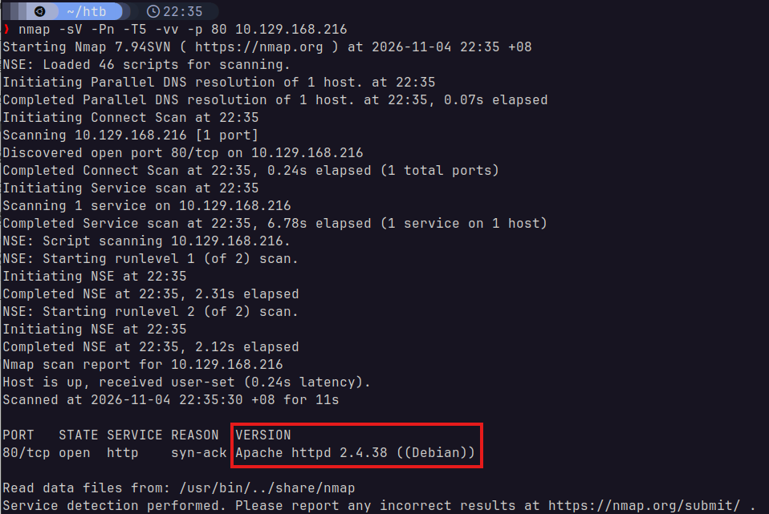
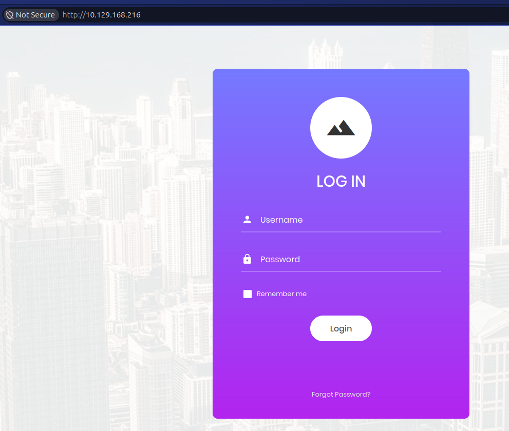
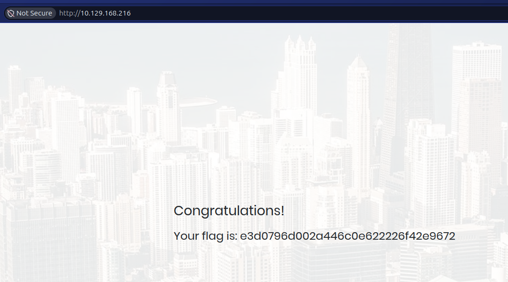
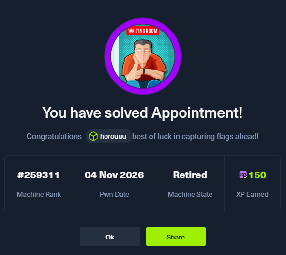

# Appointment
Starting Point - Tier 1

### 1. What does the acronym SQL stand for?
Structured Query Language

### 2. What is one of the most common type of SQL vulnerabilities?
SQL Injection

### 4. What is the 2021 OWASP Top 10 classification for this vulnerability?
(task 3 seems to have been skipped)
A03:2021-Injection

### 5. What does Nmap report as the service and version that are running on port 80 of the target?
Running `nmap` shows us the following:

> `nmap -sV -Pn -p 80 -T5 -vv 10.129.168.216`



We see that the service and version are `Apache httpd 2.4.38 ((Debian))`.

### 6. What is the standard port used for the HTTPS protocol?
443

### 7. What is a folder called in web-application terminology?
Directory

### 8. What is the HTTP response code that is returned for `Not Found` errors?
404

### 9. Gobuster is one tool used to brute force directories on a webserver. What switch do we use with Gobuster to specify we're looking to discover directories, and not subdomains?
From the manual: `dir`.

### 10. What single character can be used to comment out the rest of a line in MySQL?
The `#` character.

### 11. If user input is not handled carefully, it could be interpreted as a comment. Use a comment to login as admin without knowing the password. What is the first word on the webpage returned?

Using a browser to access `10.129.168.216:80`:



I inputted some random username and used the following SQLi input for the password:
> ```sql
> ' OR 1=1 #
> ```

This got me past the login interface and showed me the page with the flag:



This means the first word printed was `Congratulations`.

## Flag
From the picture in [11](#11-if-user-input-is-not-handled-carefully-it-could-be-interpreted-as-a-comment-use-a-comment-to-login-as-admin-without-knowing-the-password-what-is-the-first-word-on-the-webpage-returned), we may also find the flag:

`e3d0796d002a446c0e622226f42e9672`

## Solved!
