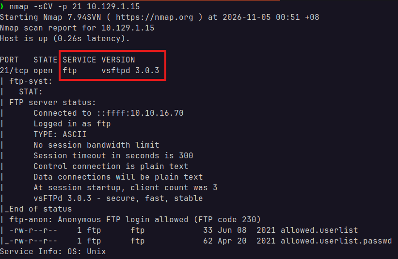
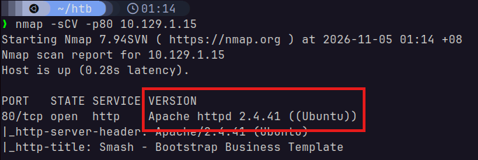
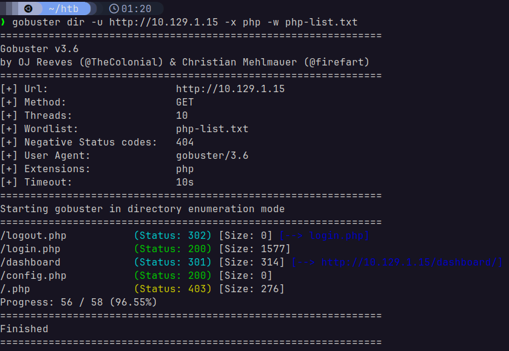
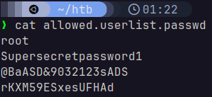
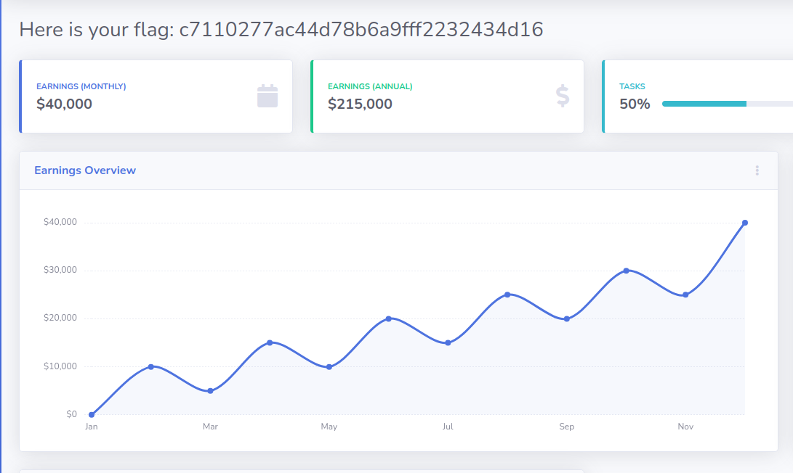

# Crocodile
Starting Point - Tier 1

### 1. What Nmap scanning switch employs the use of default scripts during a scan?
`-sC`

### 2. What service version is found to be running on port 21?
Using `nmap`:

> `nmap -sCV -p 21 10.129.1.15`

We see that the service is `ftp vsftpd 3.0.3`.

### 3. What FTP code is returned to us for the "Anonymous FTP login allowed" message?
`230`

### 4. After connecting to the FTP server using the ftp client, what username do we provide when prompted to log in anonymously?
`anonymous`

### 5. After connecting to the FTP server anonymously, what command can we use to download the files we find on the FTP server?
`get`

### 6. What is one of the higher-privilege sounding usernames in 'allowed.userlist' that we download from the FTP server?
`admin`

### 7. What version of Apache HTTP Server is running on the target host?
Running `nmap` again on the common port `80`:

> `nmap -sCV -p80 10.129.1.15`

We can see that the target is running `Apache httpd 2.4.41`.

### 8. What switch can we use with Gobuster to specify we are looking for specific filetypes?
`-x`

### 9. Which PHP file can we identify with directory brute force that will provide the opportunity to authenticate to the web service?
Running `gobuster`:

> `gobuster dir -u http://10.129.1.15 -x php -w php-list.txt`

I curated a small word-list for common PHP file names exposed in a webserver. It returned the following:

We may try `/login.php`.

## Flag
First, we can look at the password to `admin` in the downloaded `allowed.userlist.passwd` file. 

We can try the credentials `admin:rKXM59ESxesUFHAd` on `http://10.129.1.15/login.php`.

Using the browser and logging in, we get the following page:

Which contains the flag: `c7110277ac44d78b6a9fff2232434d16`!

## Solved!
